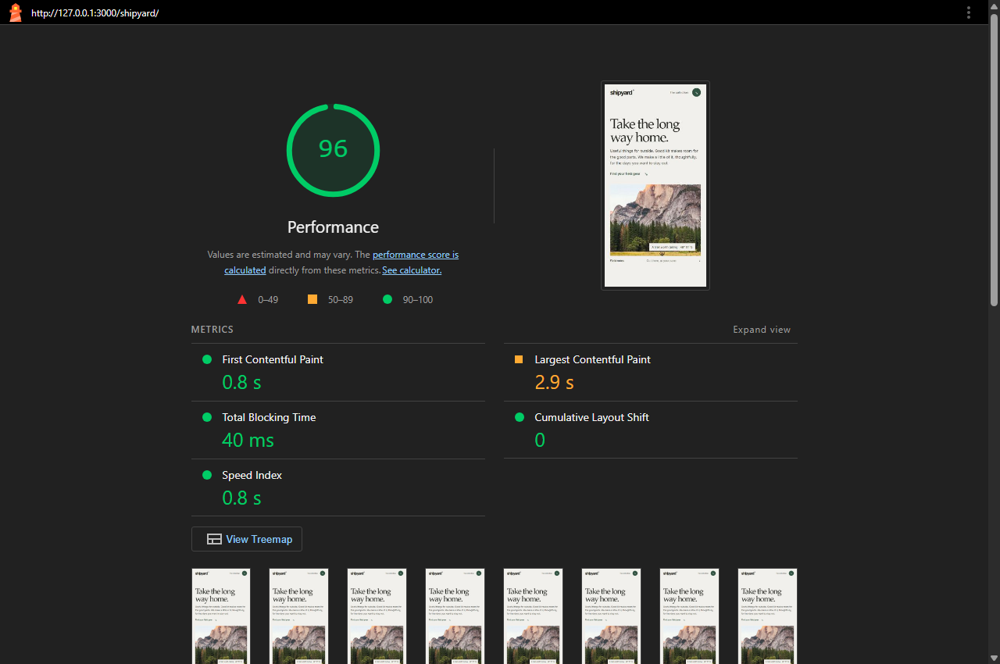

# ShipYard

A fast, resilient, and optimized product-catalog storefront built from scratch with **Next.js + TypeScript**.

**Live URL:** [https://kaustubh-negi-01.github.io/shipyard/](https://kaustubh-negi-01.github.io/shipyard/)

---

## Performance & Lighthouse Score

The deployed application scores **96/100** on Mobile Performance in Google Lighthouse:



- **Performance Score:** 96 / 100
- **First Contentful Paint (FCP):** 0.8 s
- **Largest Contentful Paint (LCP):** 2.9 s
- **Total Blocking Time (TBT):** 40 ms
- **Cumulative Layout Shift (CLS):** 0
- **Speed Index:** 0.8 s

---

## Features & Optimizations

- **Image Optimization:** Real product photography converted to WebP and rendered with `next/image` with explicit dimensions and responsive sizes, eliminating layout shift.
- **Font Optimization:** Zero external network links for fonts; Google Fonts (`Inter`) is self-hosted at build time via `next/font/google`.
- **Dynamic Lazy Loading:** Heavy below-the-fold component (`Reviews`) is code-split into its own bundle on demand with `next/dynamic` and a dedicated fallback state.
- **Per-Page Metadata:** Static metadata for `/` and dynamic per-product metadata via `generateMetadata` for `/products/[id]`.
- **Resilient States:**
  - `app/loading.tsx`: Clean loading placeholder when streaming.
  - `app/error.tsx`: Client-side error boundary with error recovery retry button.
  - `app/not-found.tsx`: Custom 404 page for unknown product IDs.
- **Static Export & CI/CD:** Static HTML export deployed to GitHub Pages via automated GitHub Actions (`.github/workflows/deploy.yml`).

---

## Run Locally

```bash
npm install
npm run dev
```

Open [http://localhost:3000](http://localhost:3000) to view the application.

## Build for Production

```bash
npm run build
```

Static export artifacts are generated in the `out/` directory.
